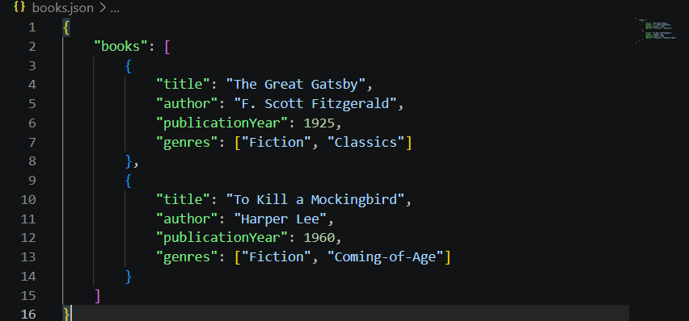
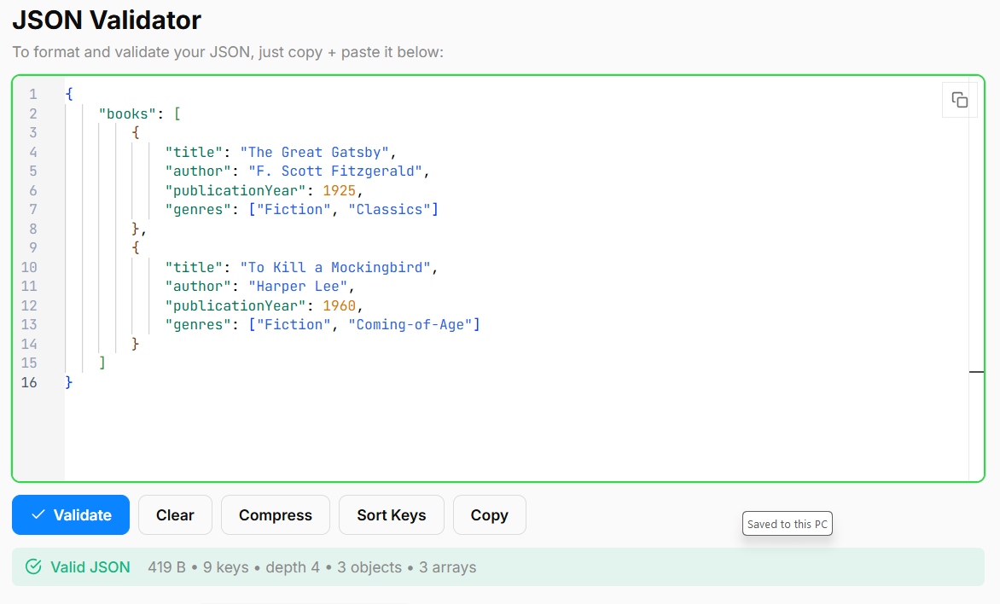
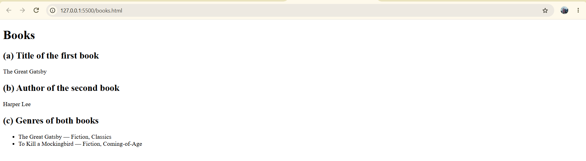
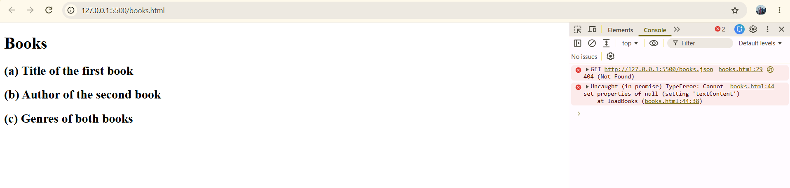
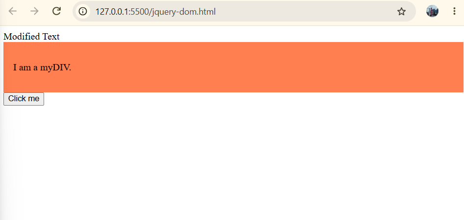
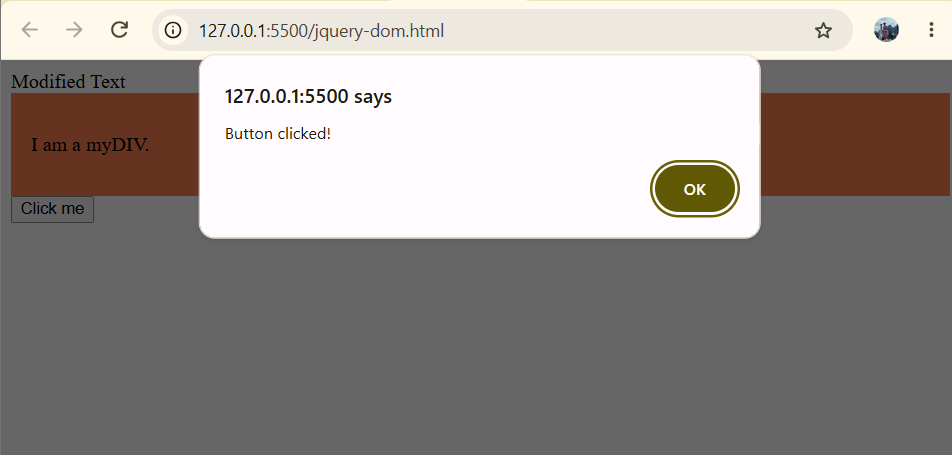

# BIC21203 Lab 4b: Client-Side Scripting (JSON and jQuery)

**Name:** Tan Jia Hong
**Student ID:** AI250230

## Overview
This repository contains three files that demonstrate JSON data, the native `fetch()` API and jQuery 4.0.0. All user-facing text is written with `textContent` (or jQuery `.text()`), not `innerHTML`.

## Question 1: Create and Structure JSON Data
**File:** `books.json**Explanation:** The file contains a top-level `"books"` array with two book objects. Each object has `title` (string), `author` (string), `publicationYear` (number) and `genres` (array of strings). Property names use double quotes and there are no trailing commas. The file was checked and parses successfully.

**Screenshots:**

## Question 2: Retrieve and Display JSON Data
**File:** `books.html**Explanation:** The page uses `fetch("books.json")` with `async/await`. It checks `response.ok`, parses the data with `response.json()` and displays (a) the title of the first book, (b) the author of the second book and (c) the genres of both books grouped by title. Elements are created with `createElement()` and text is set with `textContent`. A `try...catch` block shows a user-friendly error message if the request fails or the JSON is invalid.
**Screenshots:| Browser output (via local server) | Error message test |
|---|---|
|  |  |
__
## Question 3: Compare Native JavaScript and jQuery
**File:** `jquery-dom.html`
**Explanation:** jQuery 4.|---|---|
| `document.getElementById("myElement").textContent = "Modified Text";` | `$("#myElement").text("Modified Text");` |
| `document.querySelector("#myDIV").classList.add("myStyle");` | `$("#myDIV").addClass("myStyle");` |
| `document.getElementById("myButton").addEventListener("click", ...)` | `$("#myButton").on("click", ...)` |

**Advantage of native JavaScript:** It needs no extra library, so the page loads faster and has fewer dependencies.

**When jQuery may still be used:** An existing project that already relies on jQuery code and plugins can keep using it, because rewriting everything would be costly.

**How to run:** Open `jquery-dom.html` in a browser.

**Screenshots:**

| After page load | After clicking the button |
|---|---|
|  |  |

## Technologies_

- HTML5
- JavaScript (ES6) with `fetch()` and `async/await`
- JSON
- jQuery 4.0.0
